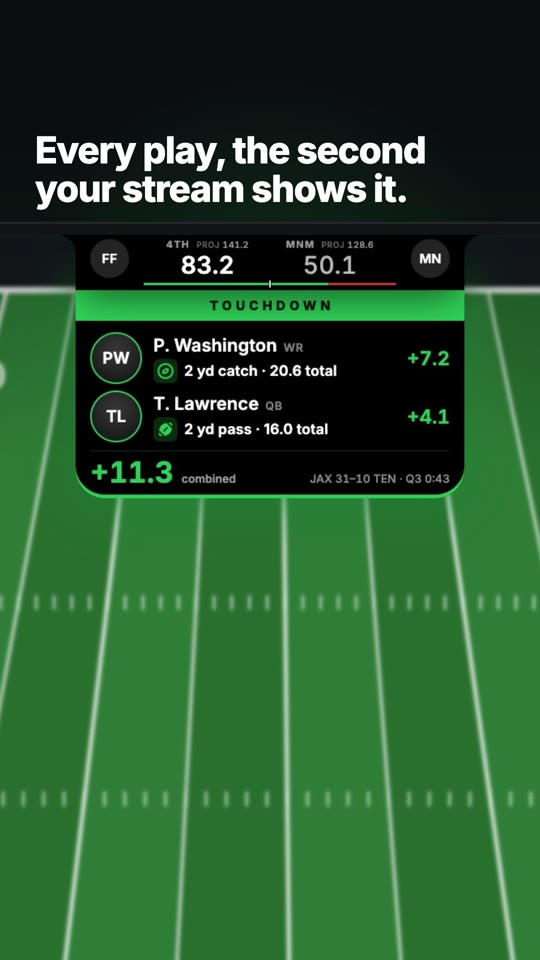
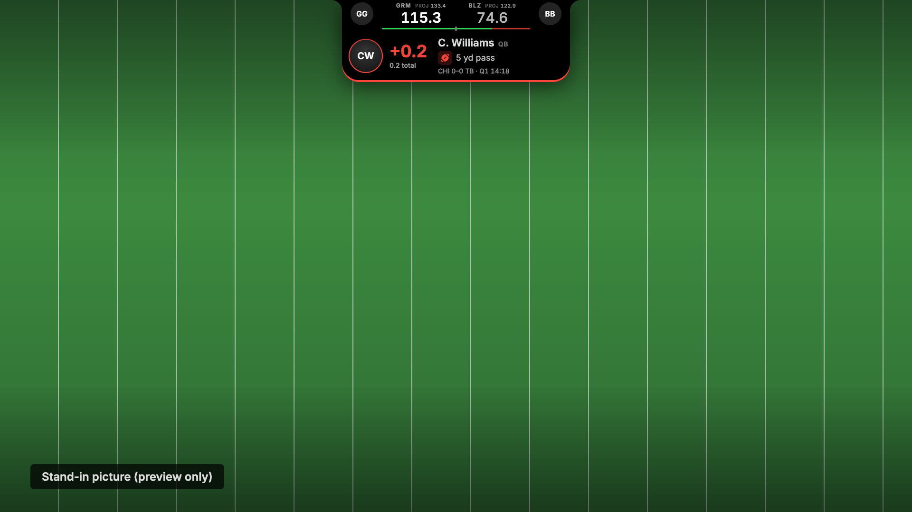
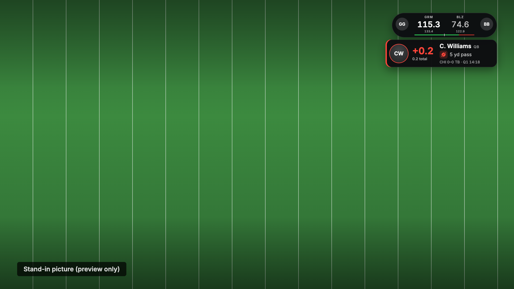
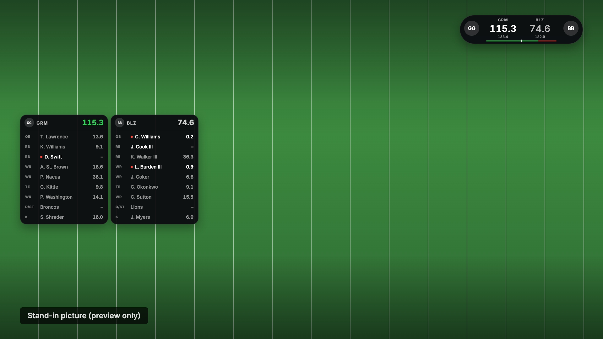
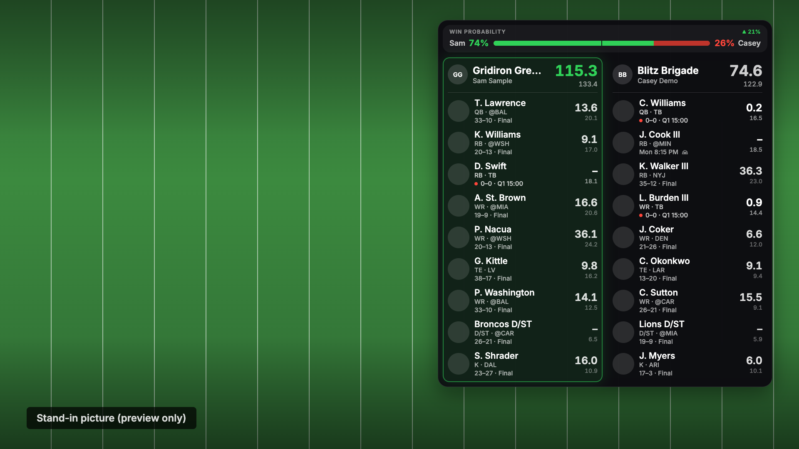
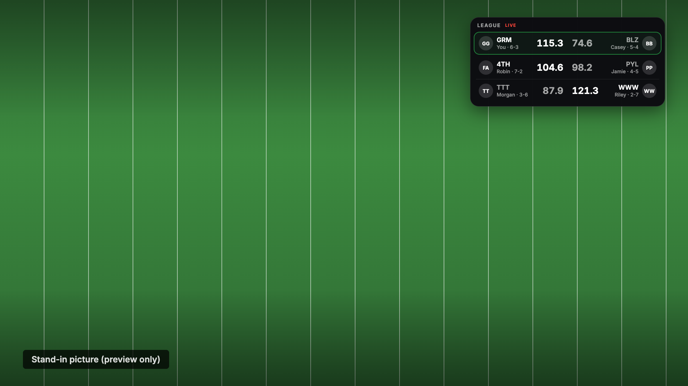
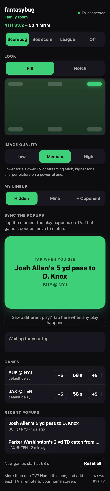

# fantasybug

Your ESPN Fantasy Football matchup, floating over whatever is on your TV.

fantasybug is a small Android TV app. While you watch the game in YouTube TV, RedZone, a cable app or
anything else, it shows your score and theirs, as a notch hanging from the top of the screen or a floating pill. When
one of the players in your matchup scores, a card pops up with what they did, timed to land when your
stream shows the play, not a minute early. A page on your phone runs it all.

<a href="docs/media/fantasybug-preview.mp4"></a>

<!-- For a player that plays right on this page: on github.com, edit this file, drag
     docs/media/fantasybug-preview.mp4 into the editor, and put the link GitHub makes here in place of
     the picture above. -->

**New here? The [user guide](docs/USER-GUIDE.md) walks you through it in about 15 minutes.**

> **Not affiliated with ESPN or the NFL.** fantasybug is an independent, unofficial project. ESPN and
> ESPN Fantasy are trademarks of ESPN, Inc. NFL is a trademark of the National Football League. It reads
> the same data your browser does when you open ESPN Fantasy, with your own login, and may stop working
> if ESPN changes how its site works.

| The notch and a popup | The pill and a popup | Your lineup beside the game |
|---|---|---|
|  |  |  |
| **Box score** | **League** | **Phone remote** |
|  |  |  |

*(The pictures use a made-up league. The green field stands in for the game you are watching.)*

## What it does

- **Scorebug, your way:** a black **notch** hanging from the top edge (slide it anywhere along the top) or a
  floating **pill** in any of six places. Both teams' scores, ESPN's projections and a live win probability.
- **Scoring popups:** one for every play that scores for your starters: the player, the play
  ("TD · 22 yd catch"), the points, and the game's score. Green for yours, red for theirs. Touchdowns get a
  bigger moment. When two of your starters are on one play (your QB to your receiver), one card shows both.
- **Red zone heads-up** when one of your starters' teams gets inside the 20 (once a drive, worked out
  from the play-by-play as your stream shows it).
- **Lead changes**, and a **final** card with each side's top scorer.
- **Box score:** every starter's points, projection, game, opponent rank, injuries, weather and bench points.
- **League view:** every matchup in your league this week.
- **Your lineup:** your starters (or both teams') down one side of the screen, lighting up as they score.
- **Image quality:** Low, Medium or High pictures, so a slow streaming stick stays quick.
- **Broadcast delay:** streams run behind the real game, often by about a minute. fantasybug holds
  each popup until ESPN's timestamp on the play plus a delay for that game (58 seconds to start), so it
  lines up with what you see. **Tap to sync** on your phone sets each game's delay in one tap.

You run it all from the **phone remote**: a page on your phone with the views, the look, your lineup, the
picture quality and tap-to-sync. No apps to install on the phone, and no TV remote buttons to set up.

## Which TVs work

| Works | Doesn't work |
|---|---|
| Google TV (Chromecast with Google TV, Google TV Streamer, Sony, TCL, Hisense and others) | Samsung (Tizen) |
| Android TV (Nvidia Shield, Xiaomi, Philips Android TV and others) | LG (webOS) |
| Amazon Fire TV on Fire OS (Fire TV Stick 4K and newer, Cube) | Roku |
| | Apple TV |

It needs Android 6 or newer and the TV's permission to "display over other apps".

**Fire TV sticks: not confirmed yet.** On one low-memory Fire TV (model AFTDCT31), an earlier build of
this overlay inside couch-tv made the stick slow down after it went idle, and the cause hasn't been found
(Android's count of open system connections climbed to about 1,700 in 40 minutes; a TCL Google TV running
the same overlay stays around 50 for days). On a stick, pick **Low** image quality and the **pill** look,
and if you can, check it with a computer before relying on it:
`adb shell dumpsys meminfo dev.fantasybug | grep Proxy` (a number that keeps climbing is the problem;
please [open an issue](../../issues) with what you see).

## Install

1. On the TV, install the free **Downloader** app (by AFTVnews) from the Play Store or Amazon Appstore.
2. In Downloader, type the code **`DOWNLOADER-CODE`** and press Go, then **Install**.
   (Or the full address: `https://github.com/RRoth5/fantasybug/releases/latest/download/fantasybug.apk`.
   With a computer, `adb install fantasybug.apk` works too.)
3. Open **fantasybug** from the TV's apps.

### Allow "Display over other apps"

fantasybug draws on top of other apps, so the TV has to allow it once. On the fantasybug screen, choose
**Allow "Display over other apps"**. If your TV opens a settings page, switch fantasybug on there.

Many Google TVs and Fire TVs have no such page. Then it is allowed once from a computer on the same
Wi-Fi, with Google's free [platform-tools](https://developer.android.com/tools/releases/platform-tools)
(switch on Developer options and USB debugging on the TV first):

```sh
adb connect <your TV's address>
adb shell appops set dev.fantasybug SYSTEM_ALERT_WINDOW allow
```

## Set up (from your phone, no computer)

1. Open fantasybug on the TV. It shows a QR code.
2. Point your phone's camera at it. Your phone must be on the same Wi-Fi as the TV.
3. On your phone, enter your **league ID**, and for a private league your **espn_s2** and **SWID**.
   [How to find them](docs/COOKIES.md) (about two minutes, on a computer, once a season).
4. Pick your team from the list.
5. Choose your broadcast delay and which popups you want.
6. Tap **Open the phone remote** and add it to your home screen. That's it.

You can change the team, the delay and the popups later with the TV remote, on the fantasybug screen.
Left and right change the delay.

### The phone remote

Once your league and team are set, the fantasybug screen on the TV shows the phone remote's QR code.
Scan it. Your phone gets:

- **Scorebug, Box score, League, Off**
- **Look:** notch or pill, and where it sits (drag the little notch along the top)
- **Image quality** and **My lineup** (hidden, yours, or both teams, and which side)
- **Sync the popups:** tap the big button the moment the play it names happens on your TV, or tap when any
  play happens and pick it from a list. Each game has its own delay, with −5/+5, Undo and Reset.
- **All your TVs in one place:** link your other fantasybug TVs with **+ Add a TV** (a code on the TV's screen
  proves you're in the room) and switch between them at the top.

Add it to your home screen and it's one tap away. The [user guide](docs/USER-GUIDE.md#4-turn-on-the-phone-remote) has
the details.

### Tuning the delay

Each game keeps its own delay. The easy way: on the phone remote, tap the big button the moment the play
it names happens on your TV, and that game's popups line up (or tap when any play happens, then pick it). Or adjust by hand: if popups arrive
**before** you see the play, add seconds; **after**, take some off.
For the curious, `adb logcat -s fantasybug` prints a `[timing]` line for every play it sees and every popup it shows.

## Your login stays on the TV

Your league ID, espn_s2 and SWID go from your phone to your TV, and from your TV **only to ESPN**. They
are stored encrypted, only on the TV, and never backed up. fantasybug has no server, no account, no
analytics and no crash reporting, so its makers never receive anything you type. The setup page only
works while the fantasybug screen is open, never shows your cookies back, and hides them like a password.
**Forget my ESPN login** on the TV deletes them. Full details: [docs/PRIVACY.md](docs/PRIVACY.md).

The espn_s2 and SWID act like a password for your ESPN account. Don't share them, and don't post them in
a GitHub issue.

## Build it yourself

You need JDK 21 and the Android SDK (platform 34).

```sh
JAVA_HOME=/path/to/jdk-21 ANDROID_HOME=/path/to/android-sdk ./gradlew assembleDebug
```

The APK lands in `app/build/outputs/apk/debug/`. [docs/RELEASING.md](docs/RELEASING.md) covers signed
release builds.

### Preview the pages in a browser

```sh
python3 tools/preview.py
```

Then open <http://localhost:8770/overlay.html?replay=week&standin=1> to play back a made-up sample week,
<http://localhost:8770/overlay.html?snapshot=week&at=110&standin=1&notch=1&box=1> for a still with the notch
and the box score, <http://localhost:8770/setup.html?k=preview> for the phone setup page, or
<http://localhost:8770/remote.html?demo=1> for the phone remote with a pretend TV. Nothing goes to ESPN.

## Support

fantasybug is free. If you like it, you can [help me pay my league dues](https://ko-fi.com/rroth5) on Ko-fi,
any amount. The phone remote has the same button at the bottom.

## Credits

Adapted from the fantasy overlay in [couch-tv](https://github.com/Seagey/couch-tv). Third-party parts are
listed in [NOTICE.md](NOTICE.md).

## License

MIT. See [LICENSE](LICENSE).
