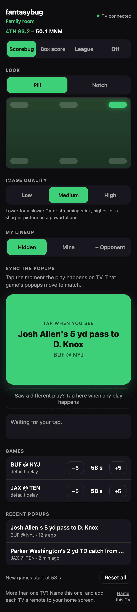

# fantasybug user guide

This guide covers putting fantasybug on your TV, connecting your ESPN league, running it from your
phone, and fixing the common problems. It takes about 15 minutes, once.

**What you need:** a Google TV, Android TV or Fire TV (not Samsung, LG, Roku or Apple TV), a phone on
the same Wi-Fi, and a computer for two minutes to copy your ESPN login if your league is private.

> **The easiest way to install it: let Claude Code do it for you.** Honestly, this is the way we recommend
> for everyone. On a computer on the same Wi-Fi as your TV:
> 1. Install [Claude Code](https://claude.com/claude-code) (it needs a paid Claude plan).
> 2. Download this repo (the green **Code** button, then **Download ZIP**, and unzip it), and open the
>    `fantasybug` folder in Claude Code.
> 3. Say: **"Install fantasybug on my TV."**
>
> It finds your TV, tells you what it will do before it touches anything, installs fantasybug, and takes
> care of the fiddly "display over other apps" step (which a Fire TV can't do without a computer). You only
> press a few buttons on the TV remote, then set up your league on your phone. Stuck at any point, with any
> method? Do the same and tell Claude Code where you got stuck.

The rest of this guide is the do-it-yourself way.

## 1. Install the app

1. On the TV, install **Downloader** (by AFTVnews) from the Play Store or the Amazon Appstore.
2. In Downloader, type the code **`6503818`** and press **Go**. Choose **Install** when the TV asks.
   (Or type the full address: `https://github.com/RRoth5/fantasybug/releases/latest/download/fantasybug.apk`.)
   (A Google TV asks you to let Downloader install apps: say yes.)

   **On a Fire TV**, it doesn't ask, so allow it first: **Settings**, **My Fire TV**, **Developer
   options**, **Install unknown apps**, then switch **Downloader** on. No **Developer options**? Go to
   **Settings**, **My Fire TV**, **About**, and press OK on the device's name (the first line) seven times;
   then go back and it's there.
3. Choose **Done** (not Open) when it's installed, then **Delete** to remove the download and save space.
   You now have a new app: **fantasybug**.

## 2. Let it draw over other apps

fantasybug floats on top of the app you're watching, so Android has to allow that once.

1. Open **fantasybug**. Choose **Allow "Display over other apps"**.
2. If a settings page opens, switch **fantasybug** on and press Back.
3. If nothing opens or the TV says there's no such page (common on Google TV and Fire TV), it has to be
   allowed once from a computer. See [Allowing it from a computer](#allowing-it-from-a-computer) below.

When it's allowed, the fantasybug screen shows **"Display over other apps": allowed**.

## 3. Connect your ESPN league (from your phone)

1. Open **fantasybug** on the TV. It shows a QR code.
2. Point your phone's camera at the code and open the link. The phone must be on the same Wi-Fi.
3. Enter your **league ID**. For a private league also enter **espn_s2** and **SWID**:
   [how to find them](COOKIES.md).
4. Press **Connect**. Your league's teams appear. Tap yours.
5. Set the **broadcast delay** (start with 58 seconds) and the **popups** you want.

No phone camera? Type the address shown under the QR code into any browser on the same Wi-Fi, then the
code shown with it.

The phone page only works while the fantasybug screen is open on the TV.

## 4. Open the phone remote

The phone remote is how you run fantasybug while you watch: the views, the look, your lineup, the picture
quality and the timing. It's a web page the TV serves to your phone. No app to install.

1. At the end of setup, tap **Open the phone remote** on your phone. Or open **fantasybug** on the TV:
   once your league and team are set, its QR code is the phone remote's. Scan it.
2. Add that page to your phone's home screen so it's one tap away: on an iPhone, **Share**, then
   **Add to Home Screen**; on Android, the **⋮** menu, then **Add to Home screen**.



The phone must be on the same Wi-Fi as the TV. The link keeps working after the TV restarts, as long as
the TV keeps the same address on your network (most routers can be told to keep it: look for "DHCP
reservation" in your router's settings). Some TVs, TCL among them, don't let apps start by themselves
after a restart or an update: then open fantasybug once on the TV to wake the phone remote.

## 5. Watch with it

Start the game in any app (YouTube TV, RedZone, a cable app, anything), then on the phone remote press
**Scorebug**. (If the fantasybug screen is still open on the TV, it closes by itself so you can see it.)

| View | You see |
|---|---|
| **Scorebug** | Both teams, the scores, projections, and a win probability line |
| **Box score** | Every starter's points, game, opponent, injuries and weather, and the bench |
| **League** | Every matchup in your league this week |
| **Off** | Nothing (and nothing is asked of ESPN while it's off) |

At the top of the phone remote you see your matchup's score as the TV has it, or why it has nothing yet
(still loading, ESPN can't be reached, no league set up).

While the scorebug is up, cards pop up on their own, one for every play that scores for your starters:

- **Scoring plays:** who, what ("22 yd catch"), the points and their total. Green for yours, red for theirs.
- **Two of your players on one play** (your QB to your receiver): one taller card with both.
- **Touchdowns:** a bigger card. Yours gets confetti; theirs, a dull red glow.
- **Red zone:** when a starter's team gets inside the 20.
- **Lead change:** when the lead switches sides.
- **Final:** who won and each side's top scorer.

You can switch any of them off in the settings (on the TV or the setup page). The scores still update.

fantasybug never takes the remote: the arrows, play and pause still go to the app you're watching.

**No game on?** Choose **Watch a sample game** on the fantasybug screen to see it with a made-up league.
Press **Off** on the phone remote (or **Stop the sample game** on the TV) to make it go away.

## 6. Make it look your way (on the phone remote)

- **Look: Pill or Notch.** The **pill** floats in one of six places: tap where it goes on the little TV.
  The **notch** hangs from the top edge of the screen like a laptop's notch: drag the little black notch
  (or the slider) to slide it along the top, and it moves on the TV as you drag. Every popup is the
  notch's width and drops out of it.
- **Image quality: Low, Medium, High.** The player and team pictures. **Low** for a streaming stick or a
  slow TV, **High** for a sharp picture on a powerful one.
- **My lineup: Hidden, Mine, + Opponent.** Your starters (or both teams') down one side of the screen,
  lighting up as they score. Tap where it sits: left or right, top, middle or bottom. It stays clear of
  the scorebug, and hides while the box score or league is open.
- **Name this TV** (at the bottom), so you can tell your TVs apart.

### More than one TV: one phone app for all of them

Install fantasybug on each TV and set it up (each TV signs in to your league on its own). Then link them,
once, from the phone remote:

1. Tap **+ Add a TV** at the top. Your other fantasybug TVs on the Wi-Fi show up by name. (Not there? Open
   fantasybug once on that TV. Or type its address: the fantasybug screen on that TV shows it.)
2. Tap the TV. It shows a **4-digit code** on its screen for two minutes. Type it on your phone and tap
   **Link**. The code proves you're in the room: nobody else on your Wi-Fi can link to your TVs without it.
3. Done. The buttons at the top switch between your TVs, and everything on the page runs the one you picked.
   Link a third TV the same way: every TV learns about all the others.

Only the phone remote links are shared between your TVs, never your ESPN login. Either TV's icon on your
phone works. If the TV whose icon you use is switched off, open the other one's.

The look, lineup and quality are kept on the TV. They can only be changed while your matchup is showing.

## 7. Get the timing right

Streams run behind the live game, often by about a minute, and ESPN logs some games faster than others.
fantasybug knows when each play really happened (ESPN stamps it) and holds each popup back by a delay, so
it shows when you see the play. **Each game has its own delay.** New games start at the **broadcast delay**
from the settings (58 seconds to begin with).

### Tap to sync (the best way)

On the phone remote, under **Sync the popups**, during a game:

1. **The named play:** the big green button names the next play fantasybug is about to pop up, for example
   **"Tap when you see Josh Allen's 5 yd pass to D. Knox"**. (Yes, that gives the play away a few seconds
   early. You only need to do it once per game.) Tap it **the moment that play happens on your TV**.
2. **Or any play:** tap **"Tap here when any play happens"** (or the big button when it doesn't name a play)
   at the moment a play happens, then pick which play it was from the list. Not there? **None of these**,
   and try again on the next play.

That game's popups now land on the play, and the result says how far it moved them. Got it wrong? **Undo**
puts it back. Each game also has **−5 / +5** buttons, and **Reset all** puts every game back to the
broadcast delay. Synced delays last for the day. **Recent popups** lists what was shown, to check it.

### Without the phone

- Popup comes **before** you see the play: **add** seconds to the broadcast delay.
- Popup comes **after**: **take some off**.

Change it on the fantasybug screen (highlight **Broadcast delay** and press left or right) or on the phone
setup page. If you switch between YouTube TV and a cable app, you may need to adjust.

## Streaming sticks and Fire TV

fantasybug works best on a Google TV or Android TV. On a **Fire TV stick**, it isn't confirmed yet: on one
low-memory model (AFTDCT31), an earlier build of this overlay slowed the stick down after it went idle, and
the cause hasn't been found. A TCL Google TV running the same overlay is fine for days. On any stick:

- Choose **Low** image quality and the **pill** look on the phone remote.
- If you have a computer, check it after an hour or so of use (see [Allowing it from a computer](#allowing-it-from-a-computer)
  for adb): `adb shell dumpsys meminfo dev.fantasybug | grep Proxy`. A number in the tens is fine; one in
  the hundreds and climbing is the problem. Please open an issue on GitHub with the number and your model.

## Allowing it from a computer

Needed on a **Fire TV** (it has no "Display over other apps" page), and on any other TV without one. You do
this once. **The easy way: Claude Code** (top of this guide) does all of the following for you. By hand:

1. On the TV, switch on **Developer options**: Settings, System (or Device Preferences), About, then press
   OK on **Build** seven times. On Fire TV: Settings, My Fire TV, About, press OK on the device name seven
   times.
2. In **Developer options**, switch on **USB debugging** (on a Fire TV it's called **ADB debugging**), and
   **Network debugging** if there is one.
3. On the computer, install Google's free
   [platform-tools](https://developer.android.com/tools/releases/platform-tools). Find the TV's address in
   its network settings.
4. Run these two commands. The TV asks "Allow USB debugging?" the first time: choose **Always allow**.

```sh
adb connect <the TV's address>
adb shell appops set dev.fantasybug SYSTEM_ALERT_WINDOW allow
```

You can switch Developer options off again afterwards.

## Troubleshooting

| Problem | Fix |
|---|---|
| The look, lineup and quality buttons are greyed out | They only work while your matchup is showing: press **Scorebug** first. |
| A Fire TV stick gets slow | Pick **Low** image quality and the **pill** look, and see [Streaming sticks and Fire TV](#streaming-sticks-and-fire-tv). |
| The phone remote says it can't reach the TV | The TV must be on and on the same Wi-Fi. If the TV restarted, open fantasybug on it once. If the TV's address changed, scan the phone remote's QR code again. |
| Nothing shows when I press Scorebug | Check "Display over other apps" is allowed (the fantasybug screen says so), and that your league and team are set. |
| The scorebug is blank or never fills in | Your ESPN login may have run out. Copy espn_s2 and SWID again and scan the QR code. Check the team is picked. |
| The phone says it can't reach the TV | The fantasybug screen must be open on the TV, and the phone on the same Wi-Fi (not a guest network). |
| The phone says the link has expired | The fantasybug screen was closed and opened again. Scan the new QR code. |
| Popups are early or late | Tap to sync on the phone remote, or change the broadcast delay (section 7). |
| A popup said "TD" but no play | ESPN's play description was late. The points are right; the caption fills in on later plays. |
| My TV's home screen changed after installing | Some TVs (TCL seen) forget a custom home screen after any install. Set your home screen again in the TV's settings. |

## Your privacy

Your league ID and cookies stay on your TV (encrypted) and only ever go to ESPN. Nobody else, including
fantasybug's makers, receives them. Details: [PRIVACY.md](PRIVACY.md).

## Remove it

Settings, Apps, **fantasybug**, Uninstall. That deletes your ESPN login from the TV too. To keep the app
but delete the login, choose **Forget my ESPN login** on the fantasybug screen.
